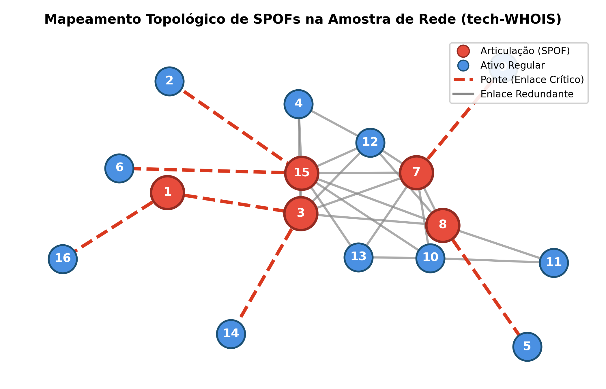
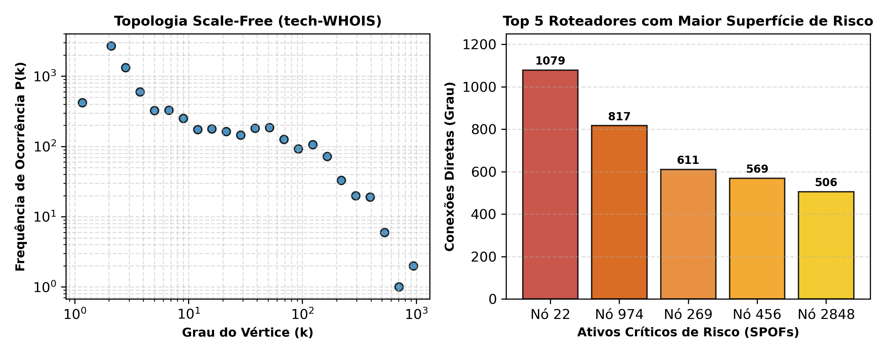

# 🛡️ Tarjan Topology Scanner

[](https://en.cppreference.com/w/cpp/17)
[](https://kernel.org)
[-success.svg?style=for-the-badge)](https://en.wikipedia.org/wiki/Tarjan%27s_strongly_connected_components_algorithm)
[](https://dcc.ufla.br)

> **Auditoria de Resiliência Estrutural e Detecção de Single Points of Failure (SPOFs) em Topologias de Redes Autônomas com Algoritmo de Tarjan linear $O(V + E)$.**

---

## 📌 Visão Geral (Segurança Defensiva e SRE)

Em engenharia de redes, cibersegurança defensiva e arquiteturas distribuídas (DevSecOps / SRE), a disponibilidade contínua de um sistema depende diretamente da **eliminação de Pontos Únicos de Falha (Single Points of Failure - SPOFs)**. Em uma topologia de roteamento ou malha de comunicação:

* **Vértices de Articulação (*Cut Vertices*):** Representam roteadores centrais, balanceadores ou Sistemas Autônomos (AS) que, ao sofrerem ataques direcionados (ex: saturação DDoS, sequestro de prefixo BGP ou pane de hardware), **fragmentam a rede em múltiplos componentes isolados**.
* **Pontes (*Cut Edges*):** Representam enlaces de fibra óptica ou canais de comunicação físicos/lógicos cuja interrupção desconecta sub-redes inteiras sem possibilidade de contingência imediata.

O **Tarjan Topology Scanner** é uma ferramenta de alta performance implementada em **C++17 moderno** (sem dependências externas) capaz de analisar topologias de grande porte em milissegundos, gerando um raio-X completo das vulnerabilidades topológicas e quantificando o blast radius (raio de impacto) de eventuais falhas.

---

## 🔬 Mapeamento Visual de SPOFs

### 1. Auditoria Topológica da Amostra de Rede
Abaixo, a visualização gerada a partir da amostra real conectada (`amostra-grafo.txt`). Vértices de articulação estão destacados em **vermelho**, nós regulares em **azul**, enlaces críticos (pontes) em **linhas tracejadas vermelhas** e conexões redundantes em **cinza**:

<p align="center">
  
</p>

### 2. Distribuição Scale-Free e Alvos Prioritários
Análise da topologia global dos registros de trânsito da Internet (**tech-WHOIS** com 7.476 nós e 56.943 arestas). O gráfico à esquerda demonstra o comportamento *scale-free* (lei de potência em escala log-log), enquanto o gráfico à direita ranqueia os roteadores SPOF com maior superfície de ataque:

<p align="center">
  
</p>

---

## ⚡ Diferenciais de Performance e Arquitetura

* **Complexidade Assintótica Linear $O(V + E)$:** Processa a rede completa de 7.476 ativos e 56.943 links em apenas **0,54 ms** em ambiente Linux.
* **Zero Variáveis Globais:** Todo o estado do percurso DFS (`tin`, `low`, `timer`, etc.) é rigidamente encapsulado na classe `TarjanSPOF`.
* **Parser Robusto de Topologias:** Suporta nativamente arquivos no formato **Matrix Market Coordinate (`.mtx`)** e listas de adjacência arbitrárias (`u v`), com filtragem automática de comentários (`%` ou `#`), auto-laços e arestas paralelas.
* **Mapeamento Transparente de Identificadores:** Converte rótulos esparsos para índices contíguos de memória, otimizando o cache de CPU através de `std::vector<std::vector<int>>`.
* **Conformidade de Estilo:** Código formatado estritamente com indentação consistente de 4 espaços e **limite de 80 colunas por linha**.

---

## 📊 Resultados Empíricos (Benchmark)

Os testes foram executados em arquitetura x86_64 Linux com compilação `-O3`:

| Métrica de Auditoria | Amostra Reduzida (`amostra-grafo.txt`) | Base Completa (`tech-WHOIS.mtx`) |
| :--- | :---: | :---: |
| **Ativos de Rede ($|V|$)** | 16 | **7.476** |
| **Enlaces de Comunicação ($|E|$)** | 27 | **56.943** |
| **Grau Médio de Conectividade ($\bar{d}$)** | 3,38 | **15,23** |
| **Componentes Conexos Iniciais** | 1 | **1 (100% conexa)** |
| **Pontos de Articulação (Roteadores SPOF)** | 5 (31,25%) | **253 (3,38%)** |
| **Pontes (Enlaces Críticos de Fibra)** | 7 (25,93%) | **437 (0,77%)** |
| **Tempo de Execução (Tarjan DFS)** | **< 0,01 ms** | **0,54 ms** |

> **Insight de Segurança:** O **Vértice 22** concentra um grau de **1.079 conexões diretas** (está conectado a mais de **14,4%** de toda a internet modelada). Como é um nó de articulação, um ataque coordenado a este ativo isola imediatamente dezenas de sistemas autônomos periféricos.

---

## 🛠️ Como Compilar e Executar

### Pré-requisitos
* Compilador C++ com suporte a **C++17** (`g++` $\ge 7.0$ ou `clang++`)
* Utilitário `make`
* Sistema operacional Linux / UNIX / WSL

### 1. Clonar o Repositório
```bash
git clone https://github.com/nicolas-mtheus/tarjan-topology-scanner.git
cd tarjan-topology-scanner
```

### 2. Compilar
```bash
make
```
*(Gera o executável otimizado `spof_audit` sem emitir warnings com `-Wall -Wextra`).*

### 3. Executar Auditorias
* **Executar na amostra de teste:**
  ```bash
  make run GRAFO=data/amostra-grafo.txt
  ```

* **Executar na topologia real completa:**
  ```bash
  make run GRAFO=data/tech-WHOIS.mtx
  ```

* **Executar diretamente com o binário:**
  ```bash
  ./spof_audit data/tech-WHOIS.mtx
  ```

### 4. Limpar Objetos e Binários
```bash
make clean
```

---

## 📂 Estrutura do Repositório

```text
tarjan-topology-scanner/
├── assets/                       # Figuras e diagramas topológicos do README
│   ├── fig1_topologia_spof.png
│   └── fig2_analise_redes.png
├── data/                         # Bases de dados para teste
│   ├── amostra-grafo.txt         # Subgrafo conexo de teste (192 bytes)
│   └── tech-WHOIS.mtx            # Topologia AS WHOIS real (7.476 nós, 56.943 links)
├── docs/                         # Documentação técnica e científica
│   ├── relatorio.pdf             # Artigo acadêmico formal (3 páginas)
│   └── relatorio.tex             # Código-fonte LaTeX do artigo
├── mini-projeto-grafos/          # Pacote idêntico ao submetido na disciplina GCC262
│   ├── amostra-grafo.txt
│   ├── link-para-grafo-completo.txt
│   ├── makefile
│   ├── relatorio.pdf
│   └── src/
├── src/                          # Código-fonte modular em C++17
│   ├── Graph.hpp / Graph.cpp     # Estrutura do grafo e lista de adjacência
│   ├── Parser.hpp / Parser.cpp   # Leitor tolerante de arquivos .mtx e edge lists
│   ├── TarjanSPOF.hpp / .cpp     # Implementação do Algoritmo de Tarjan O(V+E)
│   └── main.cpp                  # Interface CLI do scanner
├── makefile                      # Automação de compilação, execução e limpeza
├── .gitignore                    # Filtro contra binários, arquivos .o e temporários
└── README.md                     # Este documento
```

---

## 📖 Relatório Acadêmico Completo

O relatório formal deste trabalho, contendo a fundamentação matemática, pseudocódigo detalhado, análise assintótica e discussão de limitações (dinamismo BGP e custos de QoS) pode ser acessado em:  
📄 **[docs/relatorio.pdf](docs/relatorio.pdf)**

---

## 📚 Referências

1. **Rossi, R. A., & Ahmed, N. K.** (2015). *The Network Data Repository with Interactive Graph Analytics and Visualization*. AAAI Conference on Artificial Intelligence. [Network Repository](https://networkrepository.com/tech-WHOIS.php).
2. **Tarjan, R. E.** (1972). *Depth-First Search and Linear Graph Algorithms*. SIAM Journal on Computing, 1(2), 146–160.
3. **Hopcroft, J., & Tarjan, R.** (1973). *Algorithm 447: Efficient Algorithms for Graph Manipulation*. Communications of the ACM, 16(6), 372–378.

---

## 👤 Autor

* **Nicolas Matheus Lima Oliveira** (Matrícula: `202420588`)
* Curso: Ciência da Computação / Engenharia — **Universidade Federal de Lavras (UFLA)**
* Disciplina: **GCC262 - Grafos e suas Aplicações**
* GitHub: [@nicolas-mtheus](https://github.com/nicolas-mtheus)
